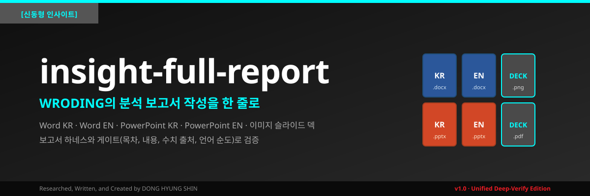
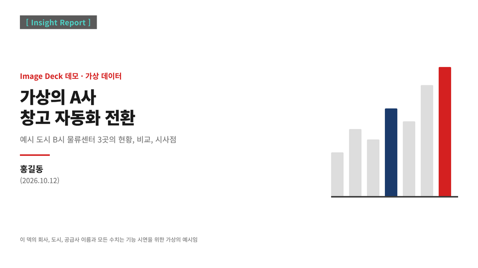
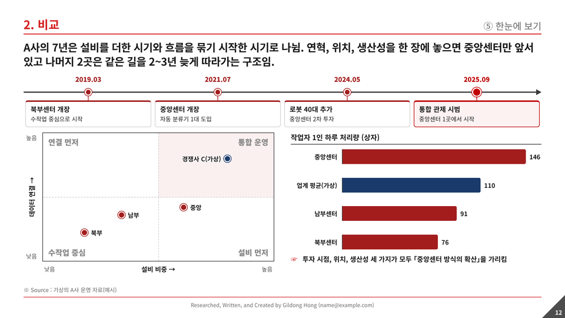
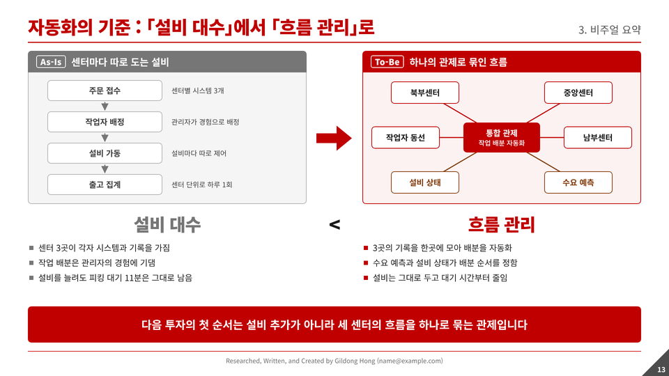
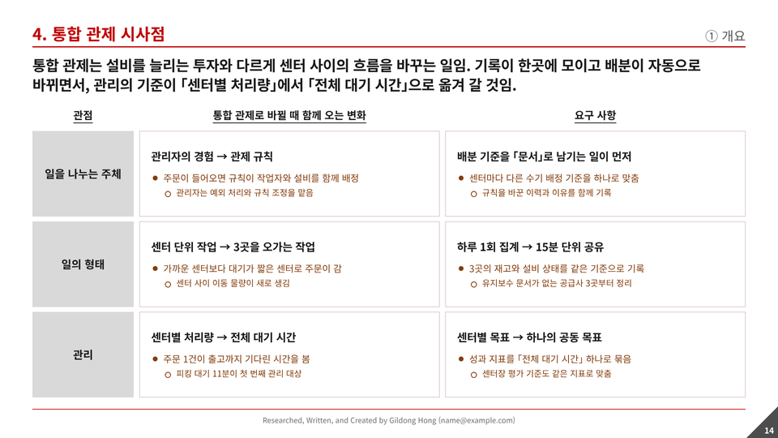

<p align="center"></p>

# insight-full-report

[](LICENSE)


분석 보고서를 Claude 에게 맡길 때 쓰는 스킬 4개 묶음(플러그인). 소스를 받아 Word·PowerPoint 한글·영문 4종을 만들고, 확정된 원고를 이미지 슬라이드 덱으로 렌더하고, 여러 에이전트가 조사·집필·검증하는 큰 보고서를 사람 확인 지점과 게이트로 관리함. 본문의 숫자는 출처 원장(`claims.json`)과 기계로 대조하고, 과장어·줄표·한자 섞임·목차 불일치는 빌드 단계에서 막음.

**In English.** A Claude plugin with four skills for analyst-style reports: bilingual Word and PowerPoint generation, image slide decks, a multi-agent report harness with human checkpoints, and a reusable quality core. Every number in the output is checked against a claims ledger, and every build passes machine gates before delivery. Install with `/plugin marketplace add dhshin0604/insight-full-report` then `/plugin install insight-full-report@wroding`, and run `python3 scripts/selftest.py` to verify your setup.

---

## 목차

1. [들어 있는 것](#1-들어-있는-것--whats-inside)
2. [설치](#2-설치--install)
3. [설치 후 확인 : doctor, selftest](#3-설치-후-확인--check-your-setup)
4. [작성자 프로필](#4-작성자-프로필--author-profile)
5. [쓰는 법 : 요청 예시](#5-쓰는-법--usage)
6. [검증 장치 : 게이트와 원장](#6-검증-장치--gates-and-the-claims-ledger)
7. [하네스 방식](#7-하네스-방식--the-harness)
8. [문제 해결](#8-문제-해결--troubleshooting)
9. [v0.9.x 에서 올릴 때](#9-v09x-에서-올릴-때--upgrading)
10. [저장소 구성](#10-저장소-구성--repository-layout)
11. [데이터와 개인정보](#11-데이터와-개인정보--data-and-privacy)
12. [버전 이력, 기여, 라이선스](#12-버전-이력-기여-라이선스)

---

## 1. 들어 있는 것 / What's inside

| 스킬 | 이럴 때 씀 | 결과물 | 검증 |
|---|---|---|---|
| **generate-full-report** v1.0 | 소스(URL, PDF, 영상, 텍스트) 몇 개로 보고서 한 벌을 빠르게 | Word 한글·영문(.docx), 글자를 고칠 수 있는 PowerPoint 한글·영문(.pptx) | 목차, 내용 규칙, 수치 출처, 16점 judge 의 4중 게이트 + 언어 순도 |
| **image-deck** v1.0 | 확정된 원고(MD)를 발표용 그림 슬라이드로 | 1920×1080 PNG, PDF, PPTX(쪽마다 그림 한 장), PNG zip, `qa_report.json` | 넘침, 겹침, 글자 크기, 색 대비 자동 QA |
| **report-harness** v1.0 | 여러 에이전트가 나눠 조사·집필하는 큰 보고서, 현황 → 분석 → 진단 → 제언 연재 | MD 토의본, Word 보고서, 이미지 덱 | 원고 자체 점검(selfcheck), 수치 출처 게이트, 독립 검토, 사용자 확인 지점 |
| **quality-core** v0.1 | 이미 있는 초안(내 글, 남의 보고서, 메일)을 검증·보강 | 고친 초안, `claims.json`, 16점 채점표 | 원장 대조(`verify_claims_lite.py`), So-What 사다리 |

어느 스킬을 쓸지는 요청 문장으로 Claude 가 고름. 편집 가능한 PPTX 는 generate-full-report, 그림 슬라이드는 image-deck, MD 토의본을 먼저 보고 확정하는 큰 보고서는 report-harness.

### 이미지 덱 견본 (가상 데이터 데모)

| 표지 | 타임라인 + 2×2 + 가로 막대 |
|---|---|
|  |  |
| **비주얼 요약 : As-Is → To-Be 도해** | **시사점 3축 표** |
|  |  |

데모 15쪽 전체는 `python3 skills/image-deck/references/examples/demo_deck.py --out demo --example-profile` 로 직접 만들 수 있음.

---

## 2. 설치 / Install

### 2-1. Claude Code (권장)

Claude Code 안에서 :

```text
/plugin marketplace add dhshin0604/insight-full-report
/plugin install insight-full-report@wroding
```

Claude Code 2.1.275 이상은 한 줄로도 됨 :

```text
/plugin install insight-full-report --marketplace dhshin0604/insight-full-report
```

터미널에서 같은 일 :

```bash
claude plugin marketplace add dhshin0604/insight-full-report
claude plugin install insight-full-report@wroding
claude plugin list                      # insight-full-report@wroding 이 보이면 설치 끝
```

- 평소에는 요청 문장만으로 스킬이 골라짐. 직접 부를 때는 `/insight-full-report:generate-full-report` 처럼 씀
- 업데이트 : `claude plugin marketplace update wroding` 다음 `claude plugin update insight-full-report@wroding` (Claude Code 를 다시 시작해야 적용)
- 삭제 : `claude plugin uninstall insight-full-report@wroding`
- 스크립트는 사용자 컴퓨터에서 돌기 때문에 3절의 프로그램(Python, Node 등)이 컴퓨터에 있어야 함

### 2-2. Claude 앱 (claude.ai 웹, 데스크톱)

**방법 A : 마켓플레이스로 추가** (저장소가 바뀌면 업데이트를 따라감)

1. Customize > Plugins > Add > **Add marketplace**
2. 저장소 주소 `https://github.com/dhshin0604/insight-full-report` 입력
3. 목록에 나온 insight-full-report 설치

**방법 B : zip 업로드**

1. 이 저장소 화면에서 **Code > Download ZIP** 으로 받음 (받은 zip 은 맨 위 폴더 하나 안에 `.claude-plugin/plugin.json` 이 있는 모양이라 그대로 올릴 수 있음)
2. Customize > Plugins > Add > **Upload plugin** 에서 그 zip 을 고름
3. 새 대화에서 「플러그인으로 들어온 스킬 목록」을 물어 4개가 보이면 끝

직접 묶으려면 `python3 scripts/package.py` → `dist/insight-full-report-plugin-v1.0.0.zip` (구조 검사까지 함)

**방법 C : 스킬만 하나씩**

1. `python3 scripts/package.py` → `dist/skills/` 에 스킬별 zip 4개(zip 맨 위가 스킬 폴더 자체)
2. Customize > **Skills** 에서 하나씩 올리고 켬
3. report-harness 는 게이트(generate-full-report)와 덱 렌더러(image-deck)를 형제 폴더에서 찾음. 셋을 함께 올리거나 방법 A, B 의 플러그인 설치를 씀

- Claude 앱에서는 스크립트가 Claude 의 코드 실행 환경에서 돎. 필요한 패키지가 없으면 스킬이 설치 명령을 안내함. 설치가 막히면 코드 실행 환경의 네트워크 허용 설정을 확인
- Team, Enterprise 플랜은 조직 관리자가 플러그인을 조직 전체에 배포할 수 있음

### 2-3. 직접 받아서 시험 (개발용)

```bash
git clone https://github.com/dhshin0604/insight-full-report.git
cd insight-full-report
python3 scripts/doctor.py          # 필요한 프로그램 점검
python3 scripts/selftest.py        # 네 스킬을 가상 프로필로 끝까지 시험
claude --plugin-dir .              # 이 폴더를 플러그인으로 불러 Claude Code 실행 (설치 없이)
```

---

## 3. 설치 후 확인 / Check your setup

### 3-1. 필요한 프로그램

| 항목 | generate-full-report | image-deck | report-harness | quality-core |
|---|---|---|---|---|
| Python 3.9 이상 | 필수 | 필수 | 필수 | 필수 |
| Node 18 이상 + npm 패키지 `docx` | 필수 (Word) | | 필수 (Word) | |
| bash | 필수 (PPTX 빌드, Windows 는 Git Bash) | | | |
| Pillow | 필수 | 필수 (PDF 묶기) | | |
| Playwright + Chromium | | 필수 | 그림, 덱을 만들 때 | |
| img2pdf, python-pptx | | 필수 | 덱을 만들 때 | |
| 한글 글꼴 | 미리보기 | 필수 | 미리보기 | |
| LibreOffice (PDF 미리보기) | 선택 | | 선택 | |

```bash
python3 scripts/doctor.py                      # 전체
python3 scripts/doctor.py --skill image-deck   # 한 스킬만
```

빠진 항목이 있으면 OS 에 맞는 설치 명령을 함께 보여 줌. 출력 예 :

```text
$ python3 scripts/doctor.py --skill report-harness       # Node 가 없는 Linux 에서
대상 스킬 : report-harness
  [OK  ] python       Python 3.13.16  (필수 : report-harness)
  [FAIL] node         node 없음  (필수 : report-harness)
         설치 : sudo apt install nodejs npm (또는 nvm 으로 Node 18 이상)
  [FAIL] docx         node 없음  (필수 : report-harness)
         설치 : node 를 먼저 설치
  [OK  ] chromium     chromium 실행 확인  (선택 : report-harness)
  ...
결과 : 꼭 필요한 항목 2개가 빠짐 (node, docx). 위 설치 명령을 실행한 뒤 다시 확인하세요.
```

OS 별 한 번에 설치 :

```bash
# macOS (Homebrew)
brew install python node
npm install -g docx
python3 -m pip install Pillow playwright img2pdf python-pptx
python3 -m playwright install chromium

# Ubuntu, Debian (apt 의 Node 가 18 미만이면 nvm 이나 NodeSource 로 올림)
sudo apt install python3-pip nodejs npm fonts-noto-cjk libreoffice-writer libreoffice-impress
npm install -g docx
python3 -m pip install Pillow playwright img2pdf python-pptx
python3 -m playwright install --with-deps chromium
```

```powershell
# Windows (PowerShell). PPTX 빌드는 Git Bash 에서 PYTHON=python 으로 실행
winget install Python.Python.3.12
winget install OpenJS.NodeJS.LTS
winget install Git.Git
npm install -g docx
py -m pip install Pillow playwright img2pdf python-pptx
py -m playwright install chromium
```

### 3-2. 자가 시험

```bash
python3 scripts/selftest.py                  # 전체 (보통 1분 안, 위 프로그램이 모두 있을 때)
python3 scripts/selftest.py --only static    # 프로그램 없이 되는 정적 검사만
python3 scripts/selftest.py --render         # LibreOffice 로 PDF 변환까지
```

가상 프로필(홍길동, name@example.com)로 임시 폴더에서 네 스킬을 끝까지 만들고 게이트까지 돌림. 저장소 파일은 바꾸지 않음. 일부러 틀린 원고(줄표, 과장어, 출처 없는 숫자)를 넣어 게이트가 실제로 잡는지도 봄. 출력 예 :

```text
$ python3 scripts/selftest.py
묶음 : static, gfr, harness, deck, core, plugin
  [PASS] static   manifest               insight-full-report 1.0.0, 마켓플레이스 wroding, JSON 파일 모두 읽힘
  [PASS] static   skill-frontmatter      generate-full-report(설명 515자, 710줄), image-deck(설명 241자, 202줄), ...
  [PASS] static   referenced-files       SKILL.md, README, CHANGELOG 가 가리키는 파일이 모두 있음
  [PASS] static   lexicon-copies         2개 사본 같음 : ...
  [PASS] static   no-em-dash             배포 파일(텍스트, Office XML)에 줄표(U+2014) 0개
  [PASS] static   privacy-scan           전화, 이메일, 개인 경로, 비밀값 모양 없음 (예시 값과 작성자 이메일만 허용)
  [PASS] static   syntax                 Python 24, JS 4, Shell 2 파일 문법 OK
  [PASS] static   package-size           파일 79개, 2.0 MB (업로드 한도 5,000개, 200 MB 안)
  [PASS] gfr      pptx-kr                13장, 게이트 toc=ok, content=ok, claims=skip, judge=skip, 언어 순도 OK
  [PASS] gfr      pptx-en                13장, 게이트 toc=ok, content=ok, claims=skip, judge=skip, 언어 순도 OK
  [PASS] gfr      word-kr                게이트 toc=skip, content=ok, claims=skip, judge=skip, 언어 순도 OK
  [PASS] gfr      word-en                게이트 toc=skip, content=ok, claims=skip, judge=skip, 언어 순도 OK
  [PASS] gfr      gate-catches           줄표와 과장어를 넣은 EN 슬라이드에서 DASH, HYPE_HARD 검출, 게이트 실패
  [PASS] harness  selfcheck              PASS
  [PASS] harness  assemble               content.json, claims.json (claim 35개)
  [PASS] harness  build-docx             report.docx 192 KB
  [PASS] harness  gate                   toc=skip, content=ok, claims=ok, judge=skip
  [PASS] harness  gate-catches           selfcheck FIX, 게이트 content=fail, claims=fail (과장어, 미등록 수치 1,234,567)
  [PASS] deck     demo-deck              PNG 15장, QA 오류 0, PDF·PPTX·zip 생성
  [PASS] core     claims-lite            맞는 초안 통과, 틀린 초안에서 REMOVED_LEAK, NUM_UNREG 검출
  [PASS] plugin   validate               claude plugin validate --strict 통과

결과 : PASS 21, FAIL 0, SKIP 0 (9초)
```

- SKIP 은 그 기능에 필요한 프로그램이 없다는 뜻. FAIL 이 있으면 작업 폴더를 남기고 경로를 알려 줌
- 묶음 : `static`, `gfr`, `harness`, `deck`, `core`, `plugin` (`--only gfr,deck` 처럼 고름)

---

## 4. 작성자 프로필 / Author profile

템플릿과 스크립트에는 이름, 전화, 이메일이 들어 있지 않음. 작성자 정보는 `profile.json` 한 곳에서 읽어 Word 표지 작성자 줄, PPTX 표지·맺음말·하단 크레딧, 이미지 덱 표지·감사 쪽에 넣음. 값이 비어 있으면 빌드가 멈추고 무엇이 비었는지 알려 주므로 `{AUTHOR_KR}` 같은 자리표시가 완성 문서에 남지 않음.

```json
{
  "AUTHOR_KR": "홍길동",
  "AUTHOR_EN": "Gildong Hong",
  "PHONE_KR": "010-0000-0000",
  "PHONE_EN": "+82-10-0000-0000",
  "EMAIL": "name@example.com",
  "BRAND": "Insight Report",
  "WORKSPACE_ROOT": "",
  "WORKSPACE_DIRNAME": ""
}
```

| 키 | 쓰는 곳 | 꼭 필요한 스킬 |
|---|---|---|
| `AUTHOR_KR`, `AUTHOR_EN` | 표지 작성자 줄, 크레딧 | 세 스킬 모두 |
| `EMAIL` | PPTX 맺음말·크레딧, 덱 감사 쪽·크레딧 | generate-full-report, image-deck |
| `PHONE_KR`, `PHONE_EN` | PPTX 맺음말, 덱 감사 쪽 | generate-full-report (덱은 비면 전화 줄을 뺌) |
| `BRAND` | 덱 표지 상단 라벨 `[ BRAND ]` | 선택 (기본 Insight Report) |
| `WORKSPACE_ROOT`, `WORKSPACE_DIRNAME` | 산출물을 모아 둘 폴더 | 선택 |

**어디에 두나** (먼저 찾는 순서)

1. 환경변수 `PROFILE=/경로/profile.json`
2. 작업 폴더의 `./profile.json` : **권장**. 플러그인을 업데이트해도 남고, 저장소에 개인 정보가 들어가지 않음
3. 각 스킬의 `references/profile.json`
4. (image-deck, report-harness) 형제 스킬 `generate-full-report/references/profile.json` : 업로드 전에 여기 하나만 채우면 세 스킬이 함께 씀

처음 쓸 때 비어 있으면 스킬이 이름과 연락처를 묻고 작업 폴더에 `./profile.json` 을 만듦.

```bash
python3 skills/generate-full-report/references/apply_profile.py --which    # 어떤 파일이 쓰이는지
python3 skills/image-deck/references/deck_core.py --which-profile           # 덱 쪽에서 본 결과
```

표지 로고 : `skills/generate-full-report/references/logo.png` (315×60px, 투명 배경)를 두거나 `LOGO=경로` 를 주면 PPTX 표지 로고 자리가 바뀜. 없으면 빈 자리로 남음.

---

## 5. 쓰는 법 / Usage

요청 문장만 쓰면 됨. 아래는 스킬별 예시.

### generate-full-report : 4종 한 벌

```text
보고서 만들어줘. 주제 : 국내 물류 로봇 시장. 소스 : (URL 2~3개 또는 PDF 첨부)
ultracode 워크플로로 4종 세트 만들어 : (주제)
```

- 흐름 : 사전 확인(프로필, 저장 위치) → 소스 분석과 챕터 설계(기본 7장, 워크플로 모드 5~9장) → 한/영 외 소스 정규화 → 초안과 claim 등록 → 팩트체크 → Word·PPTX 빌드 → 4중 게이트(실패분만 고쳐 3회 이하) → 전달
- 결과 : `{주제}_KR_Report_{YYYYMMDD}.docx`, `{주제}_EN_Report_…docx`, `{주제}_KR_Presentation_…pptx`, `{주제}_EN_Presentation_…pptx`
- `ultracode`, 「워크플로로」를 붙이면 챕터별 병렬 작성, 별도 critic 채점, 재시도 루프를 쓰는 동적 워크플로로 돎

### image-deck : 그림 슬라이드

```text
이 원고(MD)로 이미지 덱 만들어줘. 15쪽 안팎, 마지막에 비주얼 요약과 시사점 쪽
```

- 흐름 : 원고 확인 → 쪽 설계 표 → `spec.py` → 렌더와 자동 QA(오류 0 까지) → PNG 한 장씩 육안 확인 → PDF, PPTX, zip 묶기
- 원고에 없는 숫자는 쓰지 않음. 글자를 고쳐야 하는 PPTX 가 필요하면 generate-full-report 로 넘김

### report-harness : 큰 보고서, 단계별 연재

```text
보고서 하네스로 진행해줘. 대상 : (도시, 기관, 산업), 단계 : 현황. MD 토의본 먼저 보여 줘
```

- 흐름 : 착수 질문 4개(범위, 진행 순서, 산출물, 양식 원본) → 조사 갈래별 에이전트 → 다른 에이전트의 2차 검증 → MD 토의본과 토의 안건 → **사용자 확인** → 그림 → Word ∥ 덱 → 게이트 → 독립 검토 → 전달
- 「잠정안대로 확정」 한 줄로 다음 단계로 넘어감. 현황 → 분석 → 진단 → 제언을 단계마다 같은 순서로 돎

### quality-core : 초안 검증

```text
이 초안 품질 코어로 검증해줘 (파일 첨부)
```

- 결과 : 수치마다 출처를 단 `claims.json`, So-What 보강, 16점 채점표(12점 이상, 0점 없음이 합격), 고친 초안

---

## 6. 검증 장치 / Gates and the claims ledger

### 원장 (Claims Ledger)

본문의 수치, 날짜, 사건, 인용은 모두 `claims.json` 에 출처와 함께 올림.

| status | 뜻 | 본문에서 |
|---|---|---|
| `verified` | 원문으로 확인함 | 그대로 쓰고 출처 표기 |
| `estimate` | 계산·추정한 값 | 가까이에 「추정」 또는 `est.` 표기 |
| `removed` | 확인에 실패함 | **남으면 게이트 실패** |

### 게이트

| 게이트 | 스크립트 | 잡는 것 |
|---|---|---|
| toc | `verify_toc.py` | PPTX 목차와 본문 챕터 불일치 |
| content | `verify_content.py` | 헤딩 번호(HEADNUM), 글머리표, 괄호 밖 한자, 과장어, 줄표, AI 티 문형, 장 사이 가리킴, 팀 금지어 |
| claims | `verify_claims.py` | 원장에 없는 숫자(NUM_UNREG), removed 잔존, 「추정」 없는 estimate |
| judge | 16점 루브릭 (`quality_rubric.md`) | KEY MESSAGE, 근거, 산문체, 쉬운 전달, 객관성, 연결, 목차 정합, 인사이트 깊이 8기준 (12점 이상, 0점 없음) |
| 언어 순도 | `verify_lang_purity.py` | 한글 문서의 가나, 한자 과다, 영문 문서의 CJK |
| 덱 QA | `deck_core.render_all` | 넘침, 겹침, 19px 미만 글자, 색 대비 |
| 원고 점검 | `selfcheck.py` | 빌드 전에 원고 모듈에서 위 규칙 대부분과 표 규격, 날짜 형식 |

`gate_report.py` 가 넷을 합쳐 `pass` 와 `fixes[]` 를 내고, 실패하면 fixes 만 고쳐 다시 빌드함. 3회를 넘으면 멈추고 NEEDS_REVIEW 로 사람에게 넘김.

### 금지어 사전 고치기

`lexicon.json` 하나에 과장어, 평가어, AI 티 문형, 가리킴, 줄표 수준을 모아 둠. 팀 고유 금지어는 `user_banned` 에 넣음. 사본이 두 곳(`generate-full-report/references`, `report-harness/references`)이므로 둘을 같게 맞추고 `python3 scripts/selftest.py --only static` 으로 확인.

---

## 7. 하네스 방식 / The harness

지킬 것을 프롬프트의 당부로 두지 않고 파일, 스크립트, 원장, 확인 지점으로 바깥에 꺼내 둔 구조. 어느 모델이 돌려도 같은 양식과 같은 검증을 거친 결과가 나오게 함.

| 요소 | 하는 일 | 이 저장소의 실물 |
|---|---|---|
| 정본 | 새로 짓지 않고 복사해 채우는 틀 | `build_*.template.*`, `TEMPLATE.pptx`, `build_docx.js`, `deck_core.py`, 브리프 뼈대 |
| 고삐 | 할 것과 하지 말 것을 문장으로 고정 | SKILL.md 의 GATE 0, 원칙, ANTI-DRIFT 표 |
| 원장 | 모든 사실을 출처와 1:1 로 묶음 | `claims.json`, 조사 노트 |
| 게이트 | 규칙 위반을 스크립트가 잡아 멈춤 | `selfcheck.py`, `verify_*.py`, `gate_report.py`, 덱 QA |
| 분업 | 작성자와 검증자를 나눔 | 브리프 파일, 동적 워크플로 템플릿 |
| 루프 | 통과할 때까지 고치되 상한을 둠 | 재시도 3회, critic 재작성 2회, NEEDS_REVIEW |
| 사람 확인·학습 | 되돌리기 비싼 곳에서 멈추고, 교정을 다음 규칙으로 올림 | 착수 질문, MD 토의본, 「겪은 문제와 대응」 표 |

```text
P0 착수 → P1 정본 로드 → P2 조사(갈래 병렬) → P3 2차 검증 → P4 MD 토의본
                                                          ↓
                                                [사용자 확인 : 멈춤]
                                                          ↓
P8 전달 ← P7 독립 검토 ← P6 게이트·재시도 ← P5 빌드(그림 → Word ∥ 덱)
```

전체 방법론(제작 하네스 M1~M10, 브리프 규칙, 게이트 체인, 학습 루프)은 [`skills/report-harness/references/HARNESS.md`](skills/report-harness/references/HARNESS.md).

---

## 8. 문제 해결 / Troubleshooting

| 증상 | 원인 | 해결 |
|---|---|---|
| `npm 패키지 docx 없음`, `Cannot find module 'docx'` | docx 가 없거나 Node 가 전역 폴더를 못 찾음 | `npm install -g docx`, 실행할 때 `NODE_PATH="$(npm root -g)"` |
| 빌드가 종료코드 2 로 멈추고 `AUTHOR_KR` 등이 비었다고 함 | 프로필이 비어 있음 | 4절대로 `./profile.json` 을 만들거나 `PROFILE` 지정 |
| 덱 렌더가 종료코드 3 | playwright, img2pdf, python-pptx 중 빠진 것이 있음 | `python3 -m pip install playwright img2pdf python-pptx` 와 `python3 -m playwright install chromium` |
| Chromium 실행 오류 (Linux) | 시스템 라이브러리 부족 | `python3 -m playwright install --with-deps chromium` |
| 덱이나 미리보기에서 한글이 네모로 나옴 | 한글 글꼴 없음 | Linux `sudo apt install fonts-noto-cjk`. macOS, Windows 는 기본 글꼴로 됨 |
| Windows 에서 `build_pptx.sh` 가 안 돎 | bash 없음, 또는 `python3` 명령 없음 | Git Bash 에서 `PYTHON=python bash references/build_pptx.sh …` |
| PowerPoint 가 「읽을 수 없습니다」 | 다중 자리표시, 또는 Google Slides 잔존물 | `build_pptx.sh` 를 거쳐 빌드했는지 확인. 마지막 줄이 `Google 잔존물 0, metadata 0` 이어야 함 |
| `NUM_UNREG 1.1` 처럼 헤딩 번호가 미등록 숫자로 잡힘 | 메타 claim 없이 게이트를 돌림 | report-harness 는 `assemble.py` 가 만든 `claims.json` 을 씀 |
| report-harness 가 「게이트 없음」이라고 함 | 스킬을 따로 올려 형제 스킬을 못 찾음 | 플러그인으로 설치하거나 세 스킬을 함께 올림 |
| claude.ai 업로드가 `plugin.json must be at .claude-plugin/plugin.json …` 로 거부됨 | zip 안 폴더가 한 단계 더 깊거나 다른 파일이 옆에 있음 | `python3 scripts/package.py` 로 다시 묶음 |
| 스킬 하나 업로드가 거부됨 | `SKILL.md` 가 zip 맨 위에 있음 | 스킬 폴더째 묶음 (`dist/skills/*.zip`) |

---

## 9. v0.9.x 에서 올릴 때 / Upgrading

- **v0.9.x 의 PPTX 빌드는 멈출 수 있음.** v0.9.x 는 Claude 환경에 들어 있던 외부 pptx 스킬 스크립트(`unpack.py`, `pack.py` 등)의 경로에 기대는데, 최근 환경에는 그 경로에 스크립트가 없음. v1.0 은 자체 `ooxml_tools.py` 로 빌드하므로 이 문제가 없음
- Claude Code : `claude plugin marketplace update wroding` → `claude plugin update insight-full-report@wroding` → 재시작. 예전에 zip 이나 폴더 복사로 설치했다면 그 플러그인을 지우고 2절대로 다시 설치
- Claude 앱 : 예전 플러그인이나 스킬을 끄고 2-2 의 방법 A 나 B 로 다시 설치
- 스킬 폴더 안 `profile.json` 에 넣어 둔 값은 업데이트 때 사라지므로 작업 폴더 `./profile.json` 으로 옮김
- `copy_to_insights.sh`, `.ps1` 은 없어짐. 저장 위치는 generate-full-report 의 Phase 0 이 실행 환경을 보고 정함

자세한 변경은 [CHANGELOG.md](CHANGELOG.md).

---

## 10. 저장소 구성 / Repository layout

```text
insight-full-report/
├── .claude-plugin/
│   ├── plugin.json                  # 플러그인 매니페스트 (v1.0.0)
│   └── marketplace.json             # 마켓플레이스 "wroding"
├── skills/
│   ├── generate-full-report/        # 4종 생성기
│   │   ├── SKILL.md
│   │   └── references/
│   │       ├── build_kr|en.template.js, build_pptx_kr|en.template.py, TEMPLATE.pptx   # 정본 템플릿
│   │       ├── build_pptx.sh, build_pptx_checked.sh, ooxml_tools.py              # PPTX 빌드
│   │       ├── gate_report.py, verify_toc|content|claims|lang_purity.py         # 게이트
│   │       ├── lexicon.json, apply_profile.py, profile.json
│   │       └── *.md                                                              # 파이프라인, 스타일, 팩트체크, 루브릭
│   ├── image-deck/                  # 이미지 덱
│   │   └── references/ deck_core.py, bundle.py, components.md, deck-rules.md, examples/demo_deck.py
│   ├── report-harness/              # 보고서 하네스
│   │   └── references/ HARNESS.md, briefs/, wb.py, selfcheck.py, assemble.py, build_docx.js, examples/
│   └── quality-core/                # 품질 코어
│       └── references/ claims-ledger.md, so-what.md, quality-rubric.md, style-rules.md, verify_claims_lite.py
├── scripts/
│   ├── doctor.py                    # 환경 점검
│   ├── selftest.py                  # 자가 시험
│   └── package.py                   # 업로드용 zip
├── assets/                          # 배너, 덱 견본
├── CHANGELOG.md
├── LICENSE                          # MIT
└── README.md
```

---

## 11. 데이터와 개인정보 / Data and privacy

- 스크립트는 사용자 컴퓨터나 Claude 의 코드 실행 환경 안에서만 돌고 외부 서버로 아무것도 보내지 않음. 웹 조사는 스킬이 요청할 때 Claude 의 검색 도구가 함
- 저장소에는 실제 개인 정보가 없음. 예시는 모두 가상 값(홍길동, 010-0000-0000, name@example.com, 가상의 A사, B시)이고 `selftest.py` 의 privacy-scan 이 전화번호, 이메일, 개인 폴더 경로, 비밀값 모양을 검사함
- 만든 문서의 작성자 정보는 사용자의 `profile.json` 에서만 옴. 포크해서 쓸 때는 `./profile.json` 을 작업 폴더에 두면 `.gitignore` 가 커밋을 막음
- 공개하면 안 되는 낱말(고객, 내부 과제 이름 등)을 한 줄에 하나씩 적은 파일로 배포 전 검사 : `python3 scripts/selftest.py --only static --deny denylist.txt` (`denylist*.txt` 는 `.gitignore` 에 있음)

---

## 12. 버전 이력, 기여, 라이선스

| 버전 | 핵심 |
|---|---|
| **v1.0.0** (2026-10-12) | image-deck, report-harness 스킬 추가. 외부 pptx 스킬 없이 PPTX 빌드(`ooxml_tools.py`). 공용 금지어 사전과 줄표·AI 티·가리킴 검사. 마켓플레이스, doctor, selftest, package |
| v0.9.2 (2026-08-29) | 작성자 정보를 `profile.json` 으로 분리 |
| v0.9.1 | Word 헤딩 자동 번호와 HEADNUM 게이트 |
| v0.9 | 동적 워크플로 하네스, Claims Ledger, 4중 게이트 |
| v0.5 | 단일 컨텍스트 4종 생성기, 빌드 외부화 |

**기여** : 이슈와 풀 리퀘스트를 환영함. 보내기 전에 `python3 scripts/selftest.py` 가 FAIL 0 인지, `claude plugin validate --strict .` 가 통과하는지 확인. 예시에는 실제 개인·고객 정보를 넣지 않음.

**라이선스** : [MIT](LICENSE) © DH Shin (신동형)

*Researched, Written, and Created by DONG HYUNG SHIN* · **[신동형 인사이트] · WRODING Series**
